<div align="center">

# Aura Real Estate

**Nền tảng Thẩm định Giá Bất động sản và Trợ lý RAG Đa tầng Tích hợp Vòng lặp MLOps Tự hành**

[](https://www.python.org/)
[](https://fastapi.tiangolo.com/)
[](https://react.dev/)
[](https://www.docker.com/)
[](https://airflow.apache.org/)
[](https://github.com/vllm-project/vllm)
[](https://www.trychroma.com/)
[](https://www.postgresql.org/)

---

### Demo Hệ Thống Trực Quan

<div align="center">
  <a href="docs/assets/videos/chatbot-rag-demo.mp4">
    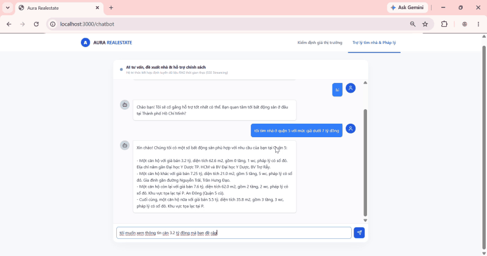
  </a>
  <p><em>Nhấp vào ảnh động GIF để xem video chất lượng cao đầy đủ (MP4, 00:16) về luồng tư vấn bất động sản Hybrid RAG streaming và định giá tự động.</em></p>
</div>

[Trực quan Demo](#2-demo-trực-quan) • [Kiến trúc Hệ thống](#3-kiến-trúc-hệ-thống) • [Tính năng Nổi bật](#4-tính-năng--điểm-kỹ-thuật-nổi-bật) • [Nghiên cứu Mô hình](#5-nghiên-cứu-mô-hình--kết-quả-thực-nghiệm) • [Cài đặt & Khởi chạy](#8-cài-đặt--khởi-chạy) • [Tài liệu API](#9-hướng-dẫn-sử-dụng-api)

</div>

---

## Mục lục

1. [Tổng quan](#1-tổng-quan)
   - [Bài toán Thực tế](#bài-toán-thực-tế)
   - [Giải pháp Aura Real Estate](#giải-pháp-aura-real-estate)
   - [3 Dịch vụ Cốt lõi](#3-dịch-vụ-cốt-lõi)
   - [Bảng So sánh Giá trị Kỹ thuật](#bảng-so-sánh-giá-trị-kỹ-thuật)
2. [Demo Trực quan](#2-demo-trực-quan)
   - [2.1. Định giá Bất động sản Tự động (AVM)](#21-định-giá-bất-động-sản-tự-động-avm)
   - [2.2. Trợ lý Tư vấn Bất động sản Stateful Hybrid RAG](#22-trợ-lý-tư-vấn-bất-động-sản-stateful-hybrid-rag)
   - [2.3. Giám sát Suy luận LLM Thời gian thực (vLLM & Grafana)](#23-giám-sát-suy-luận-llm-thời-gian-thực-vllm--grafana)
   - [2.4. Vòng lặp Multi-Agent Tự hành (LangGraph Studio)](#24-vòng-lặp-multi-agent-tự-hành-langgraph-studio)
   - [2.5. Báo cáo Thẩm định Mô hình Tự động qua Email](#25-báo-cáo-thẩm-định-mô-hình-tự-động-qua-email)
3. [Kiến trúc Hệ thống](#3-kiến-trúc-hệ-thống)
   - [S1. Kiến trúc Tổng thể (System Context & Container)](#s1-kiến-trúc-tổng-thể-system-context--container)
   - [S2. Luồng Định giá Trực tuyến (AVM Inference Flow)](#s2-luồng-định-giá-trực-tuyến-avm-inference-flow)
   - [S3. Luồng Chatbot Stateful Hybrid RAG](#s3-luồng-chatbot-stateful-hybrid-rag)
   - [S4. Pipeline Dữ liệu & Huấn luyện 24 Micro-Modules](#s4-pipeline-dữ-liệu--huấn-luyện-24-micro-modules)
   - [S5. Vòng lặp Multi-Agent Tự sửa lỗi Code & Đánh giá Model](#s5-vòng-lặp-multi-agent-tự-sửa-lỗi-code--đánh-giá-model)
   - [S6. Cơ chế Bảo mật Dual-Sandbox](#s6-cơ-chế-bảo-mật-dual-sandbox)
   - [S7. Cấu trúc Triển khai Hạ tầng (Docker Compose Topology)](#s7-cấu-trúc-triển-khai-hạ-tầng-docker-compose-topology)
   - [S8. Mô hình Thực thể Dữ liệu](#s8-mô-hình-thực-thể-dữ-liệu)
   - [S9. Hạ tầng Giám sát Metrics (vLLM, Prometheus & Grafana)](#s9-hạ-tầng-giám-sát-metrics-vllm-prometheus--grafana)
   - [S10. Vòng đời Điều phối Luồng Tự động Airflow DAG](#s10-vòng-đời-điều-phối-luồng-tự-động-airflow-dag)
4. [Tính năng & Điểm Kỹ thuật Nổi bật](#4-tính-năng--điểm-kỹ-thuật-nổi-bật)
5. [Nghiên cứu Mô hình & Kết quả Thực nghiệm](#5-nghiên-cứu-mô-hình--kết-quả-thực-nghiệm)
   - [Bộ Dữ liệu & Tiêu chuẩn Thu thập](#bộ-dữ-liệu--tiêu-chuẩn-thu-thập)
   - [Không gian Đặc trưng (Feature Matrix)](#không-gian-đặc-trưng-feature-matrix)
   - [Bảng Xếp hạng Thuật toán & Đánh giá Champion Model](#bảng-xếp-hạng-thuật-toán--đánh-giá-champion-model)
6. [Yêu cầu Hệ thống](#6-yêu-cầu-hệ-thống)
7. [Cấu hình Biến Môi trường](#7-cấu-hình-biến-môi-trường)
8. [Cài đặt & Khởi chạy](#8-cài-đặt--khởi-chạy)
   - [Quick Start 3 Lệnh với Docker Compose](#quick-start-3-lệnh-với-docker-compose)
   - [Bảng Cổng Dịch vụ Chi tiết](#bảng-cổng-dịch-vụ-chi-tiết)
   - [Chạy Phát triển Cục bộ (Local Development)](#chạy-phát-triển-cục-bộ-local-development)
   - [Hướng dẫn Vận hành Không GPU (CPU Fallback Mode)](#hướng-dẫn-vận-hành-không-gpu-cpu-fallback-mode)
9. [Hướng dẫn Sử dụng API](#9-hướng-dẫn-sử-dụng-api)
   - [POST /api/v1/predict](#post-apiv1predict)
   - [POST /api/v1/chat/stream](#post-apiv1chatstream)
   - [Bảng Danh mục API Hoàn chỉnh](#bảng-danh-mục-api-hoàn-chỉnh)
10. [Kiểm thử & Vận hành](#10-kiểm-thử--vận-hành)
11. [Cấu trúc Thư mục Dự án](#11-cấu-trúc-thư-mục-dự-án)
12. [Xử lý Sự cố (Troubleshooting)](#12-xử-lý-sự-cố-troubleshooting)
13. [Hạn chế & Định hướng Phát triển](#13-hạn-chế--định-hướng-phát-triển)
14. [Đóng góp](#14-đóng-góp)

---

## 1. Tổng quan

### Bài toán Thực tế

Thị trường giao dịch bất động sản nhà ở tại các đô thị lớn (đặc biệt là Thành phố Hồ Chí Minh) đối mặt với 4 rào cản kỹ thuật nghiêm trọng:
1. **Bất đối xứng thông tin và nhiễu giá:** Tin đăng trực tuyến chứa nhiều dữ liệu rác, giá chào ảo, định dạng diện tích/giá không chuẩn hóa, khiến người mua khó xác định giá trị thị trường thực tế.
2. **Sai số định giá phi tuyến tính:** Giá nhà phụ thuộc đồng thời vào các yếu tố vật lý (diện tích, mặt tiền, số tầng, hẻm trước nhà) và yếu tố vị trí địa lý (quận, phường, tiện ích khu vực) với độ tương tác phi tuyến mạnh, khiến các mô hình hồi quy tuyến tính đơn lẻ thất bại.
3. **Ảo giác thông tin từ LLM (Hallucination):** Các chatbot tư vấn bất động sản phổ thông thường suy diễn sai giá tiền, bịa đặt quy hoạch pháp lý hoặc nhầm lẫn giữa các phân khúc do không được neo chặt vào cơ sở dữ liệu có cấu trúc.
4. **Đứt gãy chu trình MLOps:** Khi dữ liệu bất động sản biến động theo thời gian thực (data drift), các pipeline ML truyền thống đòi hỏi kỹ sư can thiệp thủ công từ khâu cào dữ liệu, xử lý nhiễu, kiểm tra đa cộng tuyến đến chọn lựa lại siêu tham số mô hình.

### Giải pháp Aura Real Estate

**Aura Real Estate** là một hệ sinh thái mã nguồn mở toàn diện giải quyết triệt để 4 rào cản trên bằng cách kết hợp:
- **Automated Valuation Model (AVM) dạng Stacking Ensemble:** Kết hợp Ridge Regression và Random Forest làm tầng nền tảng (base learners), tổng hợp qua Linear Regression (meta learner) đạt độ chính xác cao trên phân khúc nhà riêng TP.HCM.
- **Trợ lý Tư vấn Stateful Hybrid RAG:** Sử dụng bộ trích xuất trạng thái tất định (Deterministic Regex State Parser) kết hợp cơ chế bộ nhớ trượt 2 tầng (PostgreSQL FIFO window) và bộ lọc cứng Vector Metadata (ChromaDB), triệt tiêu hoàn toàn hiện tượng suy diễn sai lệch dữ liệu.
- **Hệ thống Multi-Agent Tự hành (Self-Healing MLOps):** Kiến trúc 5 chuyên gia Agent (LangGraph) hoạt động trên Dual-Sandbox độc lập, có khả năng tự phát hiện lỗi phân phối dữ liệu, tự động sinh mã Python tối ưu, kiểm tra an toàn AST và đề xuất thăng cấp mô hình (Champion Model) có kiểm soát bởi con người (Human-in-the-loop).

### 3 Dịch vụ Cốt lõi

| | Dịch vụ | Làm gì | Công nghệ chính |
| :---: | :--- | :--- | :--- |
| **1** | **Định giá (AVM)** | Ước tính giá nhà riêng tại TP.HCM từ các thông số vật lý và vị trí, trả về giá trị ước tính và đơn giá theo m². | Stacking Ensemble (Ridge + Random Forest, meta-learner Linear Regression), log1p, kiểm soát đa cộng tuyến bằng VIF |
| **2** | **Chatbot tư vấn** | Tìm và gợi ý nhà theo nhu cầu bằng ngôn ngữ tự nhiên, ghi nhớ ngữ cảnh qua nhiều lượt, phản hồi streaming từng token. | Stateful Metadata-Filtered Dense RAG, ChromaDB, PostgreSQL, vLLM (Gemini fallback), SSE |
| **3** | **Multi-Agent cải tiến mô hình** | Phân tích kết quả pipeline, đề xuất bản vá hoặc cải tiến để nâng cao hiệu suất mô hình, kiểm chứng trong sandbox cô lập, so sánh Challenger với Champion và chờ con người phê duyệt. | LangGraph, Blackboard state, AST guard, Dual-Sandbox, Airflow |

### Bảng So sánh Giá trị Kỹ thuật

| Tiêu chí Đánh giá | Hệ thống Bất động sản Truyền thống | Aura Real Estate Architecture |
| :--- | :--- | :--- |
| **Cơ chế Định giá** | Định giá tĩnh theo bảng khung nhà nước hoặc hồi quy đơn biến OLS | **Stacking Ensemble (Ridge + Random Forest -> Linear Meta-Model)** với chuẩn hóa Log1p và kiểm định đa cộng tuyến VIF nghiêm ngặt. |
| **Bộ nhớ Chatbot** | Nhồi toàn bộ lịch sử thô vào ngữ cảnh LLM (Context Window Exhaustion) | **Kiến trúc Trạng thái Kép:** State A (JSON đặc trưng bất biến) kết hợp Window B (FIFO 6 lượt hội thoại trong PostgreSQL), tiết kiệm 80% token. |
| **Cơ chế Tìm kiếm RAG** | Tìm kiếm ngữ nghĩa thô (Cosine Similarity đơn thuần dễ sai lệch số liệu) | **Hard Metadata Pre-filtering:** Ép lọc cứng theo Quận, phân khúc giá, pháp lý trực tiếp trong ChromaDB trước khi truy vấn vector. |
| **Hạ tầng Phục vụ LLM** | Phụ thuộc hoàn toàn vào Cloud API thương mại (tốn chi phí, latency cao) | **vLLM Self-hosted engine** tối ưu PagedAttention (Qwen2.5-Coder-7B), kết hợp tự động Fallback sang Gemini Cloud khi quá tải. |
| **Cập nhật Mô hình** | Kỹ sư Data Scientist can thiệp thủ công từ EDA đến retrain | **Vòng lặp Multi-Agent tự hành:** 5 Agent tự kiểm tra dữ liệu, tự vá mã nguồn micro-module, kiểm tra an toàn qua AST Sandbox và gửi báo cáo thẩm định. |

> [!NOTE]
> **Tuyên bố Phạm vi Nghiên cứu:** Dữ liệu thực nghiệm của hệ thống được thu thập từ phân khúc nhà riêng, nhà phố tại Thành phố Hồ Chí Minh. Các giá trị định giá và tư vấn từ hệ thống mang tính chất tham khảo kỹ thuật và hỗ trợ phân tích định lượng, không thay thế văn bản thẩm định giá có chứng thư pháp lý nhà nước.

---

## 2. Demo Trực quan

### 2.1. Định giá Bất động sản Tự động (AVM)

*Ước tính giá trị thị trường bất động sản tức thời và độ tin cậy định lượng dựa trên 14 đặc trưng vật lý và vị trí.*

Hệ thống cung cấp giao diện trực quan cho phép người dùng nhập các thông số chi tiết của bất động sản (diện tích, số tầng, số phòng ngủ, phòng tắm, chiều rộng mặt tiền, bề rộng đường trước nhà, quận huyện, tình trạng pháp lý, nội thất và hướng nhà). Mô hình Stacking Regressor xử lý tức thời và trả về đơn giá theo $m^2$, giá trị ước tính tổng và biên độ tin cậy.

<div align="center">
  <a href="docs/assets/videos/predict-valuation-demo.mp4">
    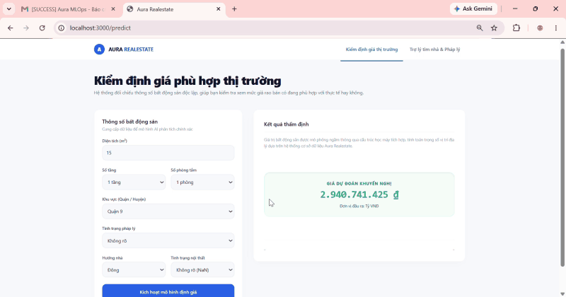
  </a>
  <p><em>Nhấp vào GIF để xem video đầy đủ (MP4, 00:08) quá trình điền thông số và nhận kết quả định giá tự động.</em></p>
</div>

<div align="center">
  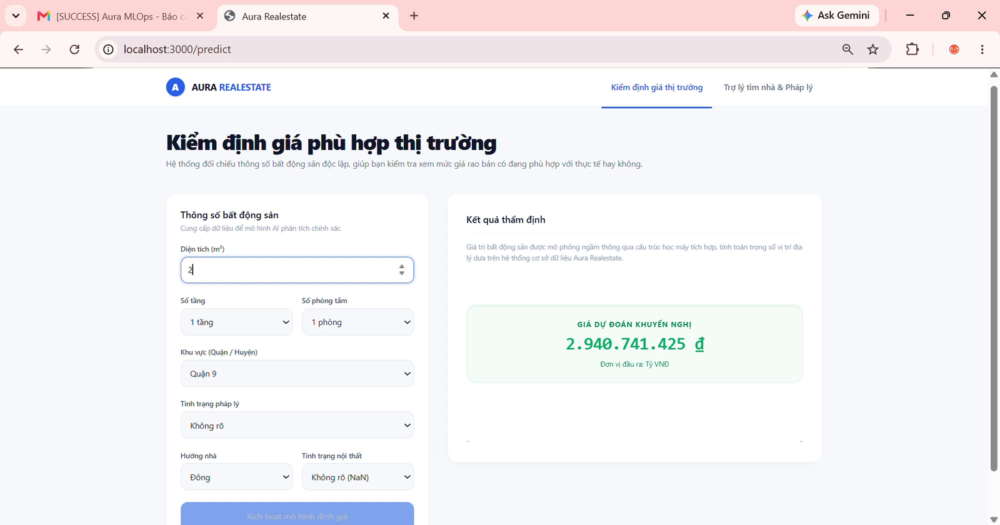
  <p><em>Giao diện Định giá Bất động sản Trực tuyến (AVM UI) phản hồi dự báo giá trị và biên độ tin cậy thời gian thực theo cấu trúc 14 đặc trưng vật lý và vị trí.</em></p>
</div>

> **Công nghệ phía sau:** [Xem Sơ đồ S2. Luồng Định giá Trực tuyến (AVM Inference Flow)](#s2-luồng-định-giá-trực-tuyến-avm-inference-flow)

---

### 2.2. Trợ lý Tư vấn Bất động sản Stateful Hybrid RAG

*Tư vấn và đề xuất bất động sản thông minh theo thời gian thực (SSE Streaming), loại bỏ hoàn toàn hiện tượng ảo giác thông tin bằng bộ lọc cứng Metadata.*

Trợ lý thông minh khai thác hạ tầng suy luận vLLM kết hợp bộ lọc cứng Metadata trên ChromaDB. Hệ thống duy trì ngữ cảnh người dùng xuyên suốt thông qua bộ nhớ trượt PostgreSQL, hỗ trợ luồng truyền dữ liệu thời gian thực dạng Server-Sent Events (SSE).

<div align="center">
  <a href="docs/assets/videos/chatbot-rag-demo.mp4">
    
  </a>
  <p><em>Nhấp vào GIF để xem video đầy đủ (MP4, 00:16) luồng tư vấn streaming từng token kết hợp trích xuất căn nhà thực tế từ ChromaDB.</em></p>
</div>

<div align="center">
  
  <p><em>Hội thoại tư vấn bất động sản theo thời gian thực (SSE Streaming) kết hợp khả năng ghi nhớ yêu cầu vị trí và ngân sách mà không suy diễn sai thông tin thị trường.</em></p>
</div>

> **Công nghệ phía sau:** [Xem Sơ đồ S3. Luồng Chatbot Stateful Hybrid RAG](#s3-luồng-chatbot-stateful-hybrid-rag)

---

### 2.3. Giám sát Suy luận LLM Thời gian thực (vLLM & Grafana)

*Quan sát hiệu năng và lưu lượng suy luận của cụm mô hình ngôn ngữ lớn (vLLM Engine) theo chuẩn công nghiệp OpenMetrics.*

Mọi yêu cầu suy luận gửi đến vLLM engine được giám sát thông qua cụm Prometheus và Grafana Dashboard với các chỉ số chuyên sâu: số lượng request xử lý, thời gian tạo token đầu tiên (TTFT), thông lượng sinh token (Token/s), tỷ lệ sử dụng KV Cache và kích thước hàng đợi scheduler.

<div align="center">
  <a href="docs/assets/videos/grafana-vllm-demo.mp4">
    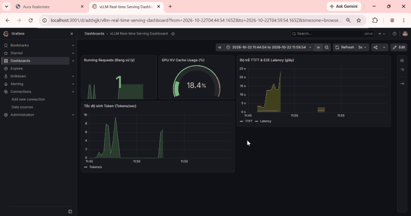
  </a>
  <p><em>Nhấp vào GIF để xem video đầy đủ (MP4, 00:09) bảng điều khiển Grafana giám sát tải GPU, TTFT latency và KV-cache utilization.</em></p>
</div>

<div align="center">
  
  <p><em>Bảng điều khiển Grafana giám sát hiệu năng suy luận mô hình vLLM theo thời gian thực, đo lường chi tiết tải GPU VRAM, TTFT latency và KV-cache utilization.</em></p>
</div>

> **Công nghệ phía sau:** [Xem Sơ đồ S9. Hạ tầng Giám sát Metrics (vLLM, Prometheus & Grafana)](#s9-hạ-tầng-giám-sát-metrics-vllm-prometheus--grafana)

---

### 2.4. Vòng lặp Multi-Agent Tự hành (LangGraph Studio)

*Điều phối chu trình MLOps tự hành thông qua 5 chuyên gia Agent, tự vá lỗi code micro-module trong môi trường Dual-Sandbox và hỗ trợ phê duyệt nhân sự.*

Khi phát hiện suy giảm chất lượng dữ liệu hoặc pipeline bị lỗi, quy trình Multi-Agent khởi động trên nền tảng LangGraph. 5 chuyên gia Agent trao đổi trạng thái qua Blackboard State, thực hiện phân tích nguyên nhân gốc rễ, sửa đổi mã nguồn micro-module và kiểm chứng trong môi trường cô lập.

<div align="center">
  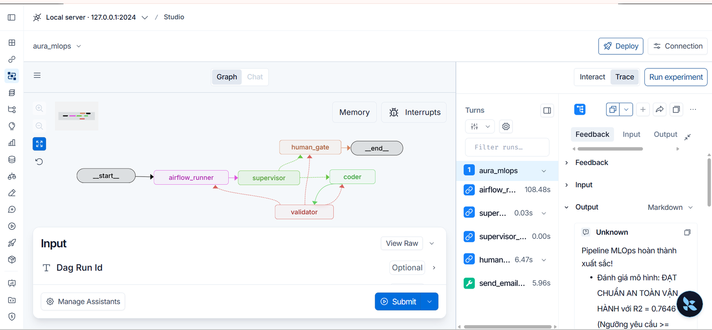
  <p><em>Sơ đồ điều phối chu trình MLOps Multi-Agent trong LangGraph Studio minh họa các trạng thái chuyển tiếp từ kiểm tra dữ liệu, sinh mã vá, chạy sandbox đến cổng phê duyệt nhân sự.</em></p>
</div>

> **Công nghệ phía sau:** [Xem Sơ đồ S5. Vòng lặp Multi-Agent Tự sửa lỗi Code & Đánh giá Model](#s5-vòng-lặp-multi-agent-tự-sửa-lỗi-code--đánh-giá-model) và [Sơ đồ S6. Cơ chế Bảo mật Dual-Sandbox](#s6-cơ-chế-bảo-mật-dual-sandbox)

---

### 2.5. Báo cáo Thẩm định Mô hình Tự động qua Email

*Kiểm toán độc lập và gửi email đối chiếu hiệu năng mô hình (Challenger vs. Champion) minh bạch tới kỹ sư trước khi thăng cấp lên môi trường production.*

Kết thúc chu trình tái huấn luyện hoặc vá lỗi tự động, Documentation Agent tổng hợp toàn bộ bảng biểu so sánh hiệu năng (R², MAE, RMSE giữa Challenger và Champion), liệt kê các bản vá mã nguồn và gửi trực tiếp qua email cho đội ngũ MLOps xem xét trước khi thăng cấp mô hình lên production.

<div align="center">
  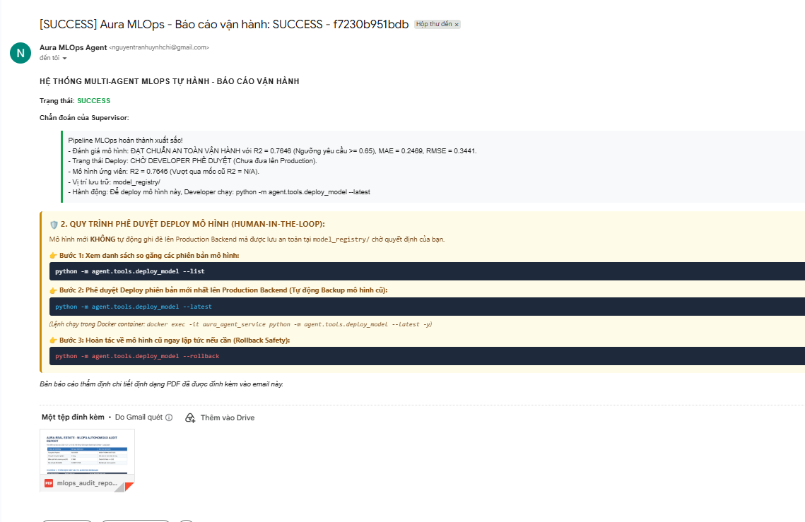
  <p><em>Báo cáo đánh giá MLOps gửi qua Email tự động, đối soát minh bạch các chỉ số đo lường trước khi kích hoạt quy trình thăng cấp mô hình chính thức.</em></p>
</div>

> **Công nghệ phía sau:** [Xem Sơ đồ S5. Vòng lặp Multi-Agent](#s5-vòng-lặp-multi-agent-tự-sửa-lỗi-code--đánh-giá-model) và [Sơ đồ S10. Vòng đời Điều phối Luồng Tự động Airflow DAG](#s10-vòng-đời-điều-phối-luồng-tự-động-airflow-dag)

---

<details>
<summary><b>📷 Xem thêm: Thư viện Hình ảnh & Poster Demo Hệ thống</b></summary>
<br/>

| Poster Thumbnail Định giá AVM | Poster Thumbnail Chatbot RAG |
| :---: | :---: |
|  | 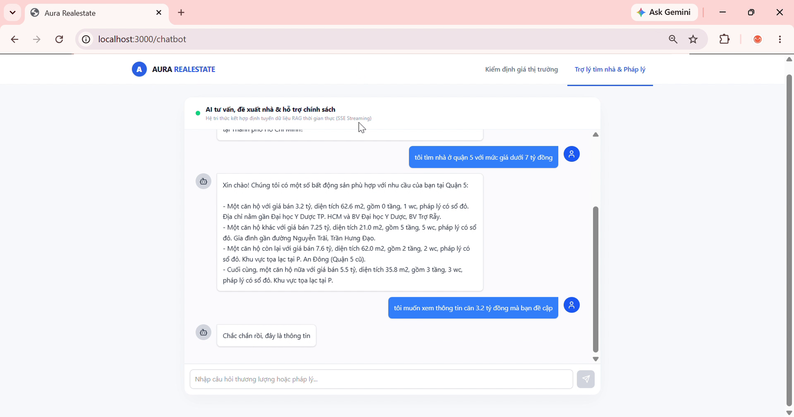 |
| *Poster frame video định giá AVM (1920x1008)* | *Poster frame video chatbot RAG (1920x1008)* |

| Poster Giám sát Grafana vLLM | Báo cáo Kiểm toán Email MLOps |
| :---: | :---: |
| 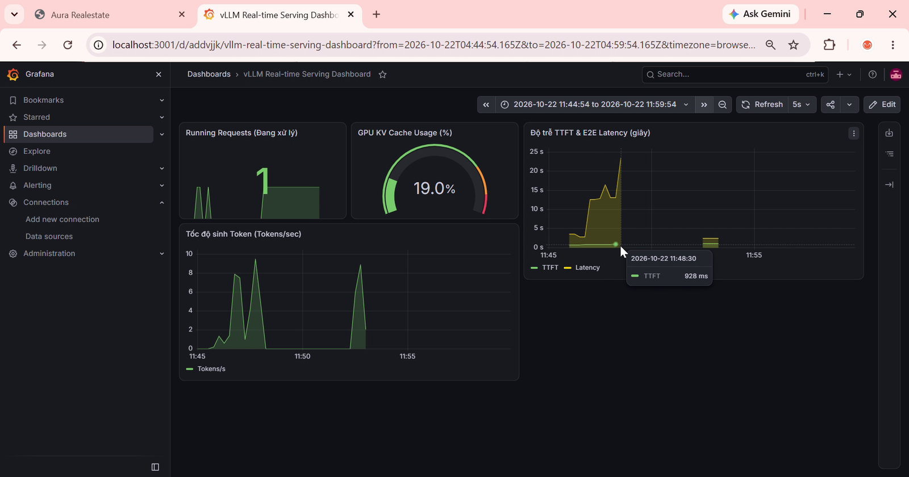 |  |
| *Poster frame video giám sát vLLM (1920x1008)* | *Ảnh chụp báo cáo email gửi cho kỹ sư MLOps* |

</details>

---

## 3. Kiến trúc Hệ thống

### S1. Kiến trúc Tổng thể (System Context & Container)

Sơ đồ mô tả ranh giới phân tách giữa hai mặt phẳng cốt lõi: **Serving Plane** (xử lý yêu cầu định giá và hội thoại người dùng với độ trễ thấp) và **MLOps Plane** (điều phối thu thập dữ liệu, phân tích EDA, huấn luyện mô hình và chu trình Multi-Agent tự hành).

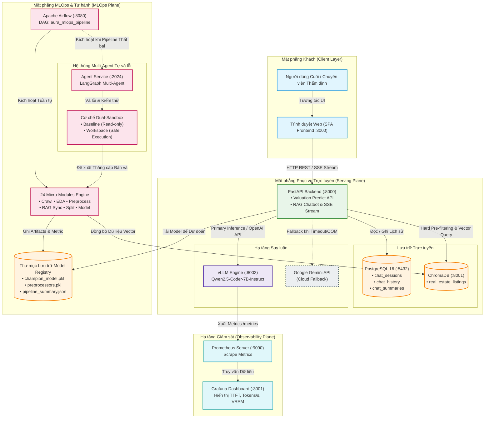

---

### S2. Luồng Định giá Trực tuyến (AVM Inference Flow)

Quy trình tuần tự từ khi giao diện người dùng gửi payload đặc trưng bất động sản đến khi mô hình Stacking Regressor xử lý giải mã ngược (inverse transform) và trả về khoảng định giá tin cậy.

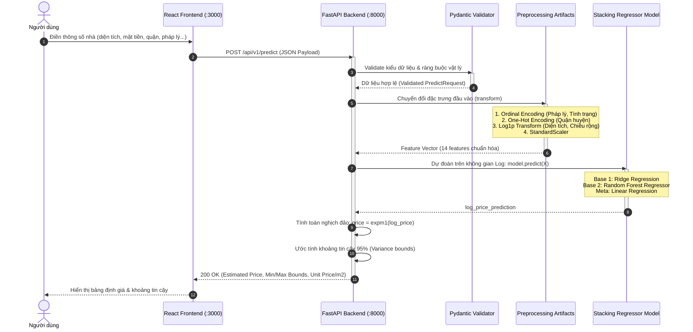

<div align="center">
  
  <p><em>Minh chứng thực tế tương ứng với luồng thiết kế S2: Giao diện AVM phản hồi dự báo giá trị tổng và đơn giá theo m² sau khi tính toán qua Stacking Regressor.</em></p>
</div>

---

### S3. Luồng Chatbot Stateful Hybrid RAG

Hệ thống RAG của Aura Real Estate áp dụng cơ chế trích xuất thực thể tất định (Deterministic Regex State Parser) để thiết lập bộ lọc cứng trong ChromaDB, phối hợp cùng vLLM và cơ chế tự động Fallback sang Gemini.

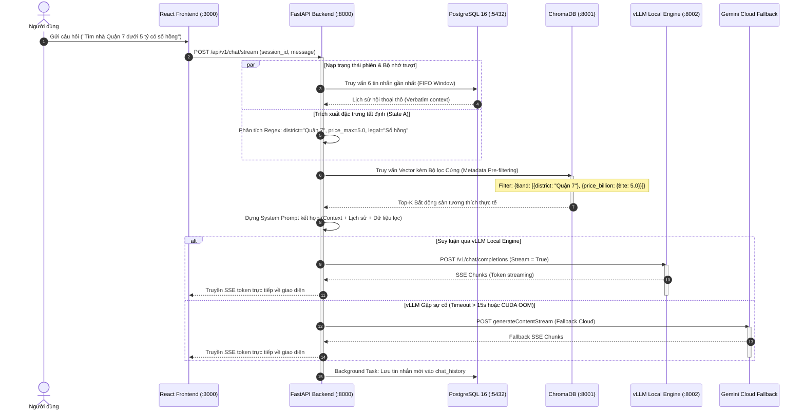

<div align="center">
  
  <p><em>Minh chứng thực tế tương ứng với luồng thiết kế S3: Giao diện Chatbot phản hồi streaming từng token qua SSE sau khi trích xuất bộ lọc cứng từ ChromaDB.</em></p>
</div>

---

### S4. Pipeline Dữ liệu & Huấn luyện 24 Micro-Modules

Toàn bộ logic xử lý dữ liệu và mô hình hóa được phân rã thành **24 vi mô-đun độc lập**, chia thành 6 giai đoạn rõ ràng. Mỗi mô-đun chịu một trách nhiệm đơn nhất, giúp quy trình MLOps dễ dàng kiểm thử, bảo trì và tự động vá lỗi.

```mermaid
flowchart TD
    classDef stage1 fill:#E3F2FD,stroke:#1565C0,stroke-width:2px;
    classDef stage2 fill:#E8F5E9,stroke:#2E7D32,stroke-width:2px;
    classDef stage3 fill:#FFF8E1,stroke:#F57F17,stroke-width:2px;
    classDef stage4 fill:#F3E5F5,stroke:#7B1FA2,stroke-width:2px;
    classDef stage5 fill:#FBE9E7,stroke:#D84315,stroke-width:2px;
    classDef stage6 fill:#EDE7F6,stroke:#4527A0,stroke-width:2px;

    subgraph G1 ["Giai đoạn 1: Thu thập Dữ liệu (1_crawler)"]
        M01["01_session_cookie.py<br/>Khởi tạo phiên & Token"]:::stage1
        M02["02_api_spider.py<br/>Thu thập phân trang tin đăng"]:::stage1
        M03["03_raw_extractor.py<br/>Trích xuất cấu trúc thô"]:::stage1
        M01 --> M02 --> M03
    end

    subgraph G2 ["Giai đoạn 2: Khám phá & Đánh giá Dữ liệu (2_eda)"]
        M04["01_missing_audit.py<br/>Kiểm toán giá trị khuyết"]:::stage2
        M05["02_collinearity_check.py<br/>Kiểm tra VIF & đa cộng tuyến"]:::stage2
        M06["03_distribution_skew.py<br/>Đo lường độ lệch phân phối"]:::stage2
        M07["04_iqr_outlier_audit.py<br/>Phát hiện dị biệt bằng IQR"]:::stage2
        M04 --> M05 --> M06 --> M07
    end

    subgraph G3 ["Giai đoạn 3: Tiền xử lý & Chuẩn hóa (3_preprocessing)"]
        M08["01_segment_filter.py<br/>Lọc phân khúc nhà riêng TP.HCM"]:::stage3
        M09["02_numeric_parser.py<br/>Ép kiểu & chuẩn hóa diện tích/giá"]:::stage3
        M10["03_physical_bounds.py<br/>Áp ngưỡng chặn vật lý thực tế"]:::stage3
        M11["04_district_encoder.py<br/>Mã hóa không gian vị trí"]:::stage3
        M12["05_category_encoder.py<br/>Mã hóa danh mục & thứ bậc"]:::stage3
        M13["06_missing_imputer.py<br/>Điền khuyết bằng trung vị cụm"]:::stage3
        M14["07_deduplicator.py<br/>Khử trùng lặp tin đa nguồn"]:::stage3
        M08 --> M09 --> M10 --> M11 --> M12 --> M13 --> M14
    end

    subgraph G4 ["Giai đoạn 4: Đồng bộ Tri thức Vector (4_rag)"]
        M15["01_chunk_builder.py<br/>Tạo Chunk & Metadata ngữ cảnh"]:::stage4
        M16["02_chroma_syncer.py<br/>Nạp & Cập nhật ChromaDB"]:::stage4
        M15 --> M16
    end

    subgraph G5 ["Giai đoạn 5: Phân tách & Biến đổi Đặc trưng (5_split)"]
        M17["01_data_splitter.py<br/>Chia Train/Val/Test (70/15/15)"]:::stage5
        M18["02_log_transform.py<br/>Biến đổi Log1p mục tiêu giá"]:::stage5
        M19["03_feature_scaler.py<br/>StandardScaler ma trận đặc trưng"]:::stage5
        M17 --> M18 --> M19
    end

    subgraph G6 ["Giai đoạn 6: Mô hình hóa & Đánh giá (6_modeling)"]
        M20["01_tune_ridge.py<br/>Tối ưu siêu tham số Ridge"]:::stage6
        M21["02_tune_tree.py<br/>Huấn luyện Decision Tree"]:::stage6
        M22["03_tune_rf.py<br/>Tối ưu Random Forest Regressor"]:::stage6
        M23["04_train_stacking.py<br/>Huấn luyện Stacking Ensemble"]:::stage6
        M24["05_evaluate_champion.py<br/>Đánh giá & Thăng cấp Registry"]:::stage6
        M20 --> M21 --> M22 --> M23 --> M24
    end

    M03 --> M04
    M07 --> M08
    M14 --> M15
    M14 --> M17
    M19 --> M20
```

---

### S5. Vòng lặp Multi-Agent Tự sửa lỗi Code & Đánh giá Model

Hệ thống tích hợp quy trình Multi-Agent xây dựng trên LangGraph. 5 Agent hoạt động xoay quanh bảng trạng thái trung tâm (**Blackboard State**), cho phép tự phục hồi khi mô hình suy giảm hiệu năng hoặc gặp lỗi phân phối dữ liệu.

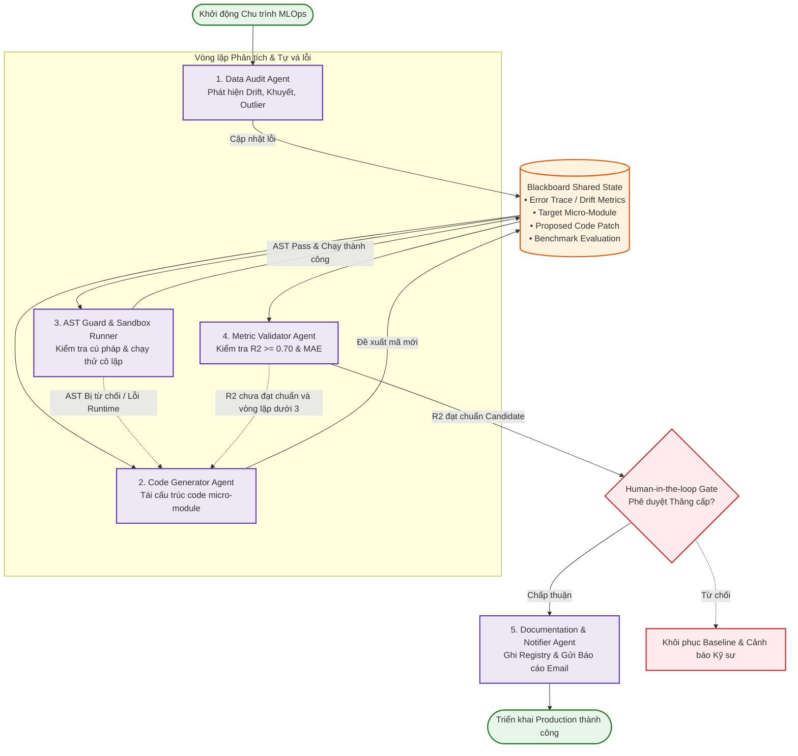

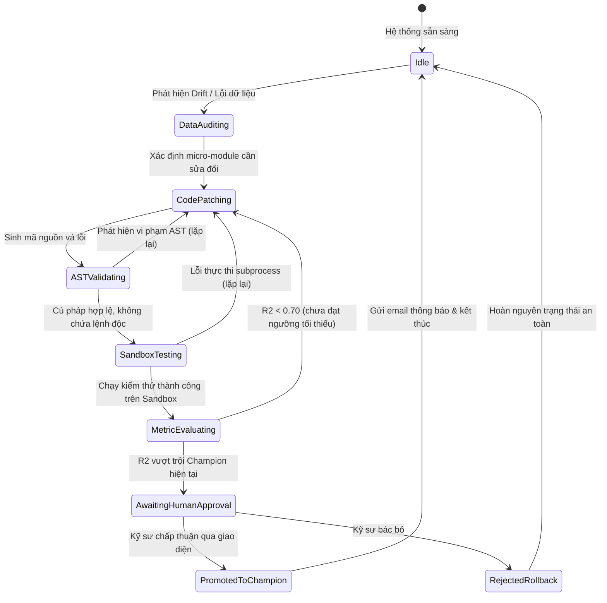

<div align="center">
  
  <p><em>Minh chứng thực tế tương ứng với luồng thiết kế S5: Điều phối chu trình Multi-Agent tự hành hiển thị trực quan trong giao diện LangGraph Studio.</em></p>
</div>

---

### S6. Cơ chế Bảo mật Dual-Sandbox

Mọi tác vụ sinh mã từ AI đều bị cô lập trong cấu trúc Sandbox 2 tầng nhằm bảo vệ tuyệt đối mã nguồn sản xuất tại `pipelines/`.

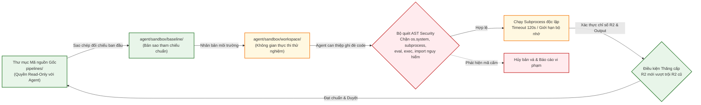

---

### S7. Cấu trúc Triển khai Hạ tầng (Docker Compose Topology)

Toàn bộ hệ thống Aura Real Estate được đóng gói chuẩn hóa thành **10 containers độc lập** trong tệp `docker-compose.yml`, kết nối qua mạng nội bộ `aura_network`.

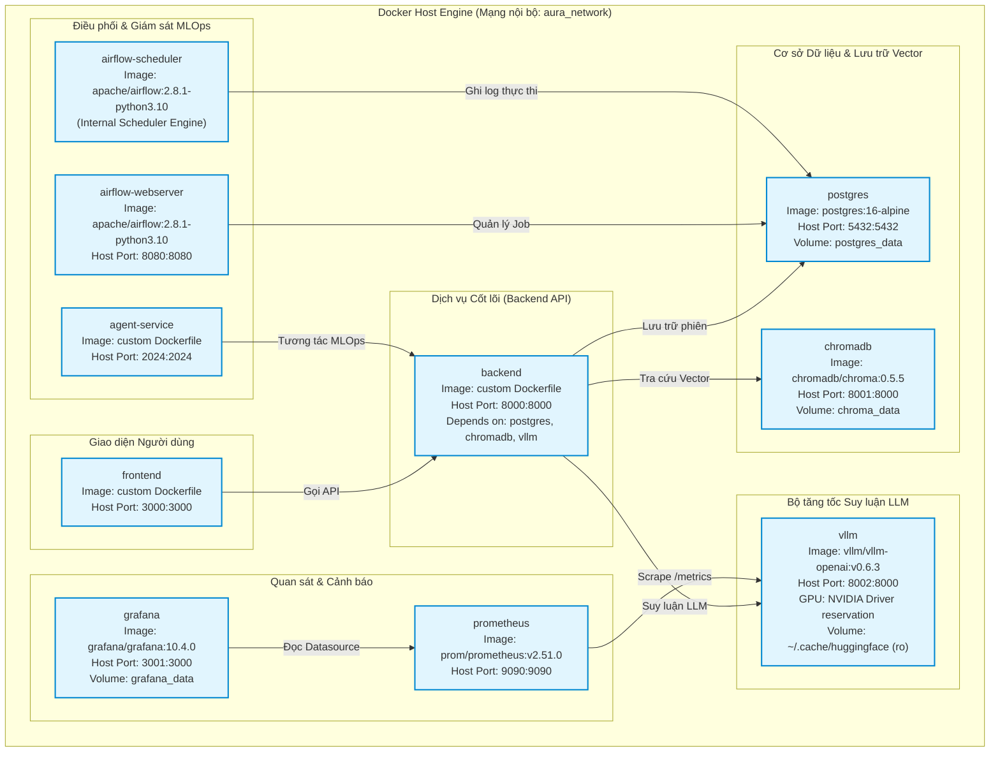

---

### S8. Mô hình Thực thể Dữ liệu

#### Thực thể Cơ sở Dữ liệu Quan hệ (PostgreSQL ERD)

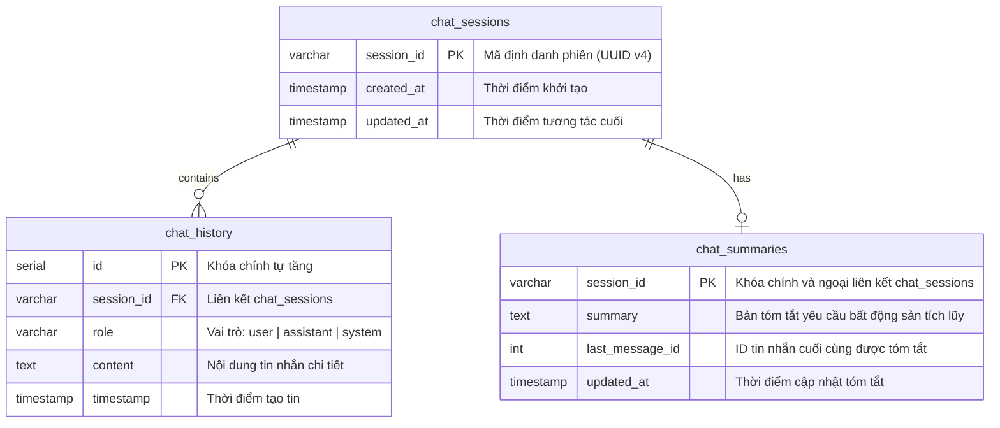

#### Cấu trúc Siêu dữ liệu Vector Collection (ChromaDB)

Tập hợp dữ liệu tri thức bất động sản được lưu trữ tại collection `real_estate_listings` với định dạng tài liệu và siêu dữ liệu (metadata) được chuẩn hóa cho việc lọc trước (pre-filtering):

```json
{
  "id": "hcm_q7_20261021_00142",
  "document": "Nhà phố đường Nguyễn Thị Thập, Phường Tân Phú, Quận 7. Diện tích 85.5m2, 3 tầng, 4 phòng ngủ, 4 toilet. Mặt tiền 5.0m, hẻm trước nhà 6.0m. Pháp lý Sổ hồng hoàn công đầy đủ, nội thất cao cấp. Giá chào bán 7.8 tỷ.",
  "metadata": {
    "listing_id": "00142",
    "district": "Quận 7",
    "price_billion": 7.8,
    "area_m2": 85.5,
    "num_floors": 3,
    "bedrooms": 4,
    "bathrooms": 4,
    "facade_width_m": 5.0,
    "access_road_width_m": 6.0,
    "legal_status": "Sổ hồng",
    "property_type": "Nhà riêng",
    "direction": "Đông Nam"
  }
}
```

---

### S9. Hạ tầng Giám sát Metrics (vLLM, Prometheus & Grafana)

Quy trình thu thập và hiển thị các chỉ số hiệu năng phục vụ suy luận LLM theo chuẩn OpenMetrics.

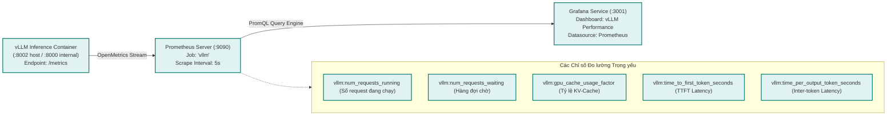

<div align="center">
  
  <p><em>Minh chứng thực tế tương ứng với luồng thiết kế S9: Bảng điều khiển Grafana thu thập và hiển thị OpenMetrics trực tiếp từ engine vLLM.</em></p>
</div>

---

### S10. Vòng đời Điều phối Luồng Tự động Airflow DAG

Quy trình điều phối MLOps định kỳ của DAG `aura_mlops_pipeline` (tệp `dags/aura_mlops_dag.py`), liên kết dữ liệu qua XCom và quản trị lỗi từng chặng.

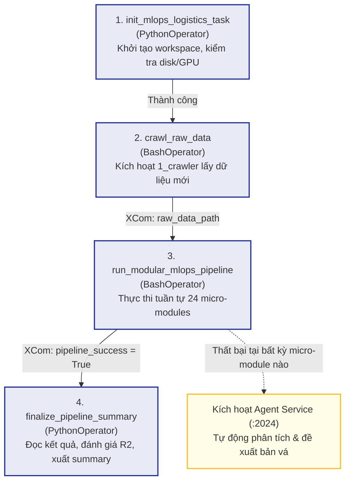

<div align="center">
  
  <p><em>Minh chứng thực tế tương ứng với luồng thiết kế S10: Email báo cáo thẩm định mô hình được Documentation Agent kích hoạt sau khi DAG hoàn tất.</em></p>
</div>

---

## 4. Tính năng & Điểm Kỹ thuật Nổi bật

| Tính năng Phục vụ | Cách Thức Triển khai Kỹ thuật | Vị trí Mã nguồn Trong Dự án |
| :--- | :--- | :--- |
| **Định giá Tự động AVM** | Mô hình **Stacking Regressor** (Ridge + Random Forest -> Linear Regression meta-model). Chuẩn hóa phi tuyến qua hàm $log(1+p)$ và biến đổi Z-score. | `pipelines/6_modeling/04_train_stacking.py`<br/>`backend/app/services/predict_service.py` |
| **Bộ nhớ Chatbot 2 Tầng** | Phân tách **State A** (JSON các thuộc tính tìm kiếm bắt buộc qua biểu thức chính quy) và **Window B** (Lấy trực tiếp 6 tin nhắn mới nhất trong PostgreSQL, không nén LLM làm mất thông tin). | `backend/app/services/chat_memory_service.py`<br/>`backend/app/schemas/chat.py` |
| **Truy vấn RAG Lọc cứng** | Áp dụng metadata pre-filtering trực tiếp trên ChromaDB cho các trường phân loại (Quận, Tình trạng pháp lý), kết hợp lọc chặn khoảng giá bằng logic Python trước khi tính tương đồng vector. | `backend/app/services/rag_service.py`<br/>`pipelines/4_rag/02_chroma_syncer.py` |
| **Truyền Dữ liệu SSE** | Hỗ trợ phản hồi chuỗi token tức thời thông qua giao thức Server-Sent Events (SSE), tối ưu trải nghiệm tương tác tự nhiên. | `backend/app/api/v1/chat.py`<br/>`frontend/src/components/Chat/ChatBox.jsx` |
| **Dự phòng Suy luận LLM** | Kiến trúc đa tầng: Ưu tiên suy luận cục bộ bảo mật qua vLLM engine, tự động chuyển hướng sang Google Gemini API khi vLLM quá tải hoặc không khả dụng. | `backend/app/services/llm_client.py` |
| **Phân tích Đa cộng tuyến** | Lọc bỏ tự động các đặc trưng có hệ số phóng đại phương sai $\text{VIF} > 10.0$ nhằm bảo toàn tính ổn định cho trọng số của mô hình hồi quy. | `pipelines/2_eda/02_collinearity_check.py` |
| **Kiểm tra An toàn AST** | Phân tích Abstract Syntax Tree (AST) của mọi bản vá code sinh ra từ LLM, tự động từ chối nếu phát hiện các hàm gọi nguy hiểm (`os.system`, `subprocess`, `__import__`). | `agent/src/tools/sandbox_tools.py` |
| **Giám sát OpenMetrics** | Thu thập chỉ số phân phối độ trễ và lưu lượng GPU VRAM qua cổng `/metrics` của vLLM, đồng bộ hóa về Prometheus và Grafana. | `docker-compose.yml`<br/>`monitoring/prometheus.yml` |

---

## 5. Nghiên cứu Mô hình & Kết quả Thực nghiệm

### Bộ Dữ liệu & Tiêu chuẩn Thu thập

- **Nguồn dữ liệu:** Nền tảng Batdongsan.com.vn (khu vực Thành phố Hồ Chí Minh).
- **Phân khúc đối tượng:** Nhà riêng, nhà mặt phố, nhà liền kề đô thị.
- **Quy mô tập mẫu:**
  - Tổng số bản ghi thô thu thập: **2,845 mẫu**.
  - Số bản ghi đạt chuẩn sau tiền xử lý và khử trùng lặp: **2,263 mẫu sạch**.
  - Phân chia tập dữ liệu: Train (**1,584 mẫu** - 70%), Validation (**339 mẫu** - 15%), Test (**340 mẫu** - 15%).
- **Ngưỡng biên vật lý áp dụng:**
  - Diện tích: $15m^2 \le \text{diện tích} \le 500m^2$.
  - Mức giá: $0.5 \text{ tỷ} \le \text{giá bán} \le 80 \text{ tỷ VNĐ}$.
  - Mặt tiền và đường vào: $1.0m \le \text{độ rộng} \le 40m$.

### Không gian Đặc trưng (Feature Matrix)

Sau quá trình sàng lọc đa cộng tuyến và tiền xử lý, mô hình huấn luyện dựa trên **14 đặc trưng cốt lõi**:

| Tên Đặc trưng | Kiểu Dữ liệu | Phương thức Tiền xử lý | Ý nghĩa Nghiệp vụ |
| :--- | :--- | :--- | :--- |
| `area_m2` | Float | Log1p Transform + StandardScaler | Diện tích sử dụng thực tế của bất động sản ($m^2$) |
| `num_floors` | Integer | Median Imputation + Scaler | Số tầng xây dựng của ngôi nhà |
| `num_bedrooms` | Integer | Median Imputation + Scaler | Số phòng ngủ |
| `num_bathrooms` | Integer | Median Imputation + Scaler | Số phòng vệ sinh / toilet |
| `facade_width_m` | Float | Log1p Transform + StandardScaler | Chiều rộng mặt tiền tiếp giáp đường ($m$) |
| `access_road_width_m`| Float | Log1p Transform + StandardScaler | Độ rộng của ngõ/hẻm hoặc đường trước nhà ($m$) |
| `district` | Categorical | Target Encoding / Frequency Rank | Quận/Huyện tại TP.HCM (Quận 1, Quận 7, Bình Thạnh...) |
| `legal_status` | Categorical | Ordinal Mapping (Sổ hồng > Sổ đỏ > HĐMB) | Tình trạng giấy tờ pháp lý sở hữu |
| `furniture_state` | Categorical | Ordinal Mapping (Đầy đủ > Cơ bản > Không có)| Tình trạng trang bị nội thất kèm theo |
| `house_direction` | Categorical | Frequency Encoding | Hướng nhà (Đông Nam, Nam, Bắc, Tây...) |
| `facade_to_road_ratio`| Float | Derived Feature + StandardScaler | Tỷ lệ giữa chiều rộng mặt tiền và đường vào |
| `area_per_floor` | Float | Derived Feature + StandardScaler | Tỷ lệ diện tích chia theo số tầng |
| `bed_to_bath_ratio`| Float | Derived Feature + StandardScaler | Tỷ lệ cân đối giữa số phòng ngủ và phòng tắm |
| `is_central_district`| Binary | Boolean (1 = Q1, Q3, Bình Thạnh; 0 = Ngoại thành)| Chỉ số định danh khu vực trung tâm kinh tế |

### Bảng Xếp hạng Thuật toán & Đánh giá Champion Model

Dữ liệu đối chiếu trực tiếp từ nhật ký thẩm định chính thức tại `model_registry/20261021_050841/pipeline_summary.json` trên tập kiểm thử độc lập (Test Set):

| Thuật toán Mô hình | Vai trò Kiến trúc | $R^2$ Score | MAE (Log Price) | RMSE (Log Price) | Trạng thái Đánh giá |
| :--- | :--- | :---: | :---: | :---: | :--- |
| **Decision Tree Regressor** | Thử nghiệm cơ sở | 0.6750 | 0.2980 | 0.4012 | Bị loại (Underfitting nhẹ) |
| **Baseline Champion (Cũ)** | Sản xuất phiên bản trước | 0.7183 | 0.2710 | 0.3750 | Lưu trữ lịch sử |
| **Ridge Regression** | Base Model 1 | 0.7420 | 0.2585 | 0.3592 | Đạt chuẩn Base Learner |
| **Random Forest Regressor** | Base Model 2 | 0.7610 | 0.2491 | 0.3470 | Đạt chuẩn Base Learner |
| **Stacking Regressor** | **Ensemble (Ridge + RF -> Linear)** | **0.7646** | **0.2469** | **0.3441** | **Champion Đương nhiệm (Promoted)** |

> [!TIP]
> **Nhận xét Thực nghiệm:** Mô hình Stacking Regressor cải thiện $R^2$ thêm **+0.0463** so với Champion cũ. Việc kết hợp một mô hình tuyến tính có điều chuẩn (Ridge) và một mô hình cây ngẫu nhiên (Random Forest) giúp khử nhiễu cục bộ trong khi vẫn nắm bắt tốt tính phi tuyến tính của dữ liệu bất động sản đô thị.

---

## 6. Yêu cầu Hệ thống

- **Hệ điều hành:** Linux (Ubuntu 22.04 LTS khuyến nghị) hoặc Windows 11 với WSL2 (Ubuntu kernel).
- **CPU:** Tối thiểu 4 Cores (khuyến nghị 8 Cores trở lên cho các tác vụ tiền xử lý).
- **RAM:** Tối thiểu 16GB RAM (khuyến nghị 32GB RAM khi chạy toàn bộ 10 container đồng thời).
- **Dung lượng Ổ cứng:** Tối thiểu 30GB dung lượng trống (SSD NVMe) phục vụ Docker images và trọng số mô hình.
- **GPU (Khuyến nghị cho vLLM):** NVIDIA GPU với tối thiểu **6GB - 8GB VRAM** hỗ trợ CUDA compute capability >= 7.0 (GTX 1660 Ti, RTX 3060/4060 trở lên).
- **Phần mềm Nền tảng:**
  - Docker Engine v24.0+ & Docker Compose v2.20+
  - NVIDIA Container Toolkit (nếu sử dụng GPU trên Docker)
  - Python 3.10+ & Node.js 20+ (nếu chạy môi trường phát triển nội bộ)

---

## 7. Cấu hình Biến Môi trường

Sao chép tệp mẫu và cập nhật các thông số bảo mật trước khi vận hành:

```bash
cp .env.example .env
```

| Tên Biến | Giá trị Mặc định | Bắt buộc | Mục đích & Mô tả Kỹ thuật |
| :--- | :--- | :---: | :--- |
| `POSTGRES_DB` | `aura_realestate` | Có | Tên cơ sở dữ liệu quan hệ cho dịch vụ chat |
| `POSTGRES_USER` | `aura_admin` | Có | Tên tài khoản quản trị PostgreSQL |
| `POSTGRES_PASSWORD` | `<your-db-password>` | Có | Mật khẩu truy cập cơ sở dữ liệu PostgreSQL |
| `POSTGRES_HOST` | `postgres` (hoặc `localhost`) | Có | Địa chỉ máy chủ PostgreSQL |
| `POSTGRES_PORT` | `5432` | Có | Cổng kết nối PostgreSQL |
| `CHROMA_HOST` | `chromadb` (hoặc `localhost`)| Có | Địa chỉ máy chủ ChromaDB Vector Store |
| `CHROMA_PORT` | `8001` (host) / `8000` (net) | Có | Cổng kết nối ChromaDB API |
| `VLLM_API_BASE` | `http://vllm:8000/v1` | Có | Base URL của engine vLLM tương thích chuẩn OpenAI |
| `VLLM_MODEL_NAME` | `Qwen/Qwen2.5-Coder-7B-Instruct` | Có | Tên mô hình LLM nạp trong vLLM |
| `GEMINI_API_KEY` | `<your-google-gemini-api-key>` | Tùy chọn | API Key của Google Gemini dùng cho nhánh Fallback |
| `AIRFLOW_FERNET_KEY` | `<your-generated-fernet-key>` | Có | Khóa mã hóa bảo mật metadata của Apache Airflow |
| `AIRFLOW_WEBSERVER_SECRET_KEY` | `<your-webserver-secret-key>` | Có | Khóa ký session của giao diện Airflow Webserver |
| `ALERT_EMAIL_SENDER` | `<your-email>@gmail.com` | Tùy chọn | Địa chỉ Gmail gửi thông báo báo cáo MLOps |
| `ALERT_EMAIL_PASSWORD` | `<your-gmail-app-password>` | Tùy chọn | Mật khẩu ứng dụng (App Password) của Gmail |
| `ALERT_EMAIL_RECEIVER` | `<target-receiver>@gmail.com`| Tùy chọn | Địa chỉ email người nhận thông báo kiểm toán |

> [!IMPORTANT]
> **Hướng dẫn Tạo Khóa Airflow Fernet Key Hợp lệ:**
> Tuyệt đối không sử dụng chuỗi văn bản thông thường làm Fernet Key. Hãy sinh khóa mã hóa Base64 bằng lệnh Python sau:
> ```bash
> python -c "from cryptography.fernet import Fernet; print(Fernet.generate_key().decode())"
> ```

---

## 8. Cài đặt & Khởi chạy

### Quick Start 3 Lệnh với Docker Compose

Khởi động toàn bộ cụm 10 dịch vụ chỉ với 3 thao tác:

```bash
# Bước 1: Sao chép mã nguồn dự án
git clone https://github.com/your-username/aura-realestate.git
cd aura-realestate

# Bước 2: Thiết lập cấu hình môi trường
cp .env.example .env
# Chỉnh sửa biến môi trường trong .env nếu cần thiết

# Bước 3: Xây dựng và khởi chạy toàn bộ hệ thống
docker compose up -d --build
```

### Bảng Cổng Dịch vụ Chi tiết

Đối chiếu chính xác theo `docker-compose.yml`:

| Tên Dịch vụ Container | Cổng Trên Host | Cổng Trong Container | Giao thức | Mục đích Chức năng |
| :--- | :---: | :---: | :---: | :--- |
| **frontend** | `3000` | `3000` | HTTP | Giao diện Single Page Application (React 19) |
| **backend** | `8000` | `8000` | HTTP / SSE | API Server chính (FastAPI AVM & RAG Stream) |
| **chromadb** | `8001` | `8000` | HTTP / REST | Cơ sở dữ liệu Vector lưu trữ tin đăng bất động sản |
| **postgres** | `5432` | `5432` | TCP | Cơ sở dữ liệu lưu trữ phiên và tin nhắn chat |
| **airflow-webserver**| `8080` | `8080` | HTTP | Giao diện quản lý và kích hoạt DAG MLOps |
| **airflow-scheduler**| *Không trỏ* | *Internal* | - | Engine điều phối tiến trình nền Airflow |
| **vllm** | `8002` | `8000` | HTTP / OpenAI | Engine suy luận LLM gia tốc GPU (PagedAttention) |
| **prometheus** | `9090` | `9090` | HTTP | Hệ thống lưu trữ và truy vấn chuỗi thời gian Metrics |
| **grafana** | `3001` | `3000` | HTTP | Bảng điều khiển trực quan hóa hạ tầng và LLM |
| **agent-service** | `2024` | `2024` | HTTP | Dịch vụ điều phối Multi-Agent (LangGraph) |

### Chạy Phát triển Cục bộ (Local Development)

Nếu muốn phát triển và gỡ lỗi trực tiếp mà không cần đóng gói container:

#### 1. Khởi chạy Dịch vụ Backend (FastAPI)
```bash
# Tạo và kích hoạt môi trường ảo
python -m venv venv
# Windows:
.\venv\Scripts\activate
# Linux/macOS:
source venv/bin/activate

# Cài đặt thư viện
pip install -r backend/requirements.txt

# Khởi chạy máy chủ phát triển
uvicorn backend.app.main:app --host 0.0.0.0 --port 8000 --reload
```

#### 2. Khởi chạy Giao diện Frontend (React)
```bash
cd frontend
npm install
npm run dev
# Truy cập giao diện tại http://localhost:3000
```

### Hướng dẫn Vận hành Không GPU (CPU Fallback Mode)

Trong trường hợp máy chủ hoặc máy phát triển không trang bị card đồ họa NVIDIA chuyên dụng:
1. Trong tệp `docker-compose.yml`, tắt container `vllm` hoặc chú thích (comment) phần `deploy.resources.reservations.devices`.
2. Trong tệp `.env`, điền `GEMINI_API_KEY` hợp lệ.
3. Backend sẽ tự động phát hiện `vllm` không khả dụng và kích hoạt cơ chế **Gemini Cloud Fallback** với độ trễ thấp trên CPU mà không làm gián đoạn tính năng RAG Chatbot.

---

## 9. Hướng dẫn Sử dụng API

### POST /api/v1/predict

Dự đoán giá trị thị trường của bất động sản nhà ở tại TP.HCM.

**Yêu cầu (cURL):**
```bash
curl -X POST "http://localhost:8000/api/v1/predict" \
     -H "Content-Type: application/json" \
     -d '{
       "area_m2": 75.0,
       "num_floors": 3,
       "num_bedrooms": 3,
       "num_bathrooms": 3,
       "facade_width_m": 4.5,
       "access_road_width_m": 5.0,
       "district": "Quận 7",
       "legal_status": "Sổ hồng",
       "furniture_state": "Cơ bản",
       "house_direction": "Đông Nam"
     }'
```

**Phản hồi Mẫu (JSON):**
```json
{
  "success": true,
  "data": {
    "estimated_price_billion": 6.85,
    "price_range_low_billion": 6.42,
    "price_range_high_billion": 7.28,
    "price_per_m2_million": 91.33,
    "model_version": "20261021_050841",
    "algorithm": "StackingRegressor[Ridge,RandomForest]->LinearRegression"
  },
  "message": "Định giá thành công"
}
```

### POST /api/v1/chat/stream

Giao thức truyền dữ liệu luồng Server-Sent Events (SSE) cho trợ lý tư vấn.

**Ví dụ Triển khai Phía Client (JavaScript Fetch):**
```javascript
const response = await fetch("http://localhost:8000/api/v1/chat/stream", {
  method: "POST",
  headers: { "Content-Type": "application/json" },
  body: JSON.stringify({
    session_id: "usr_session_98234",
    message: "Tôi có khoảng 7 tỷ, muốn mua nhà có sổ hồng tại Quận 7"
  })
});

const reader = response.body.getReader();
const decoder = new TextDecoder();

while (true) {
  const { value, done } = await reader.read();
  if (done) break;
  const chunk = decoder.decode(value);
  console.log("Token nhận được:", chunk);
}
```

**Ví dụ Triển khai Client bằng Python:**
```python
import json
import requests

url = "http://localhost:8000/api/v1/chat/stream"
payload = {
    "session_id": "usr_session_98234",
    "message": "Tìm nhà mặt tiền hẻm xe hơi tại Bình Thạnh dưới 8 tỷ"
}

with requests.post(url, json=payload, stream=True) as r:
    for line in r.iter_lines():
        if line:
            decoded_line = line.decode('utf-8')
            print(decoded_line)
```

### Bảng Danh mục API Hoàn chỉnh

| Phương thức | Đường dẫn Endpoint | Tham số Chính | Mô tả Kỹ thuật |
| :---: | :--- | :--- | :--- |
| `GET` | `/` | Không | Kiểm tra trạng thái hoạt động (Healthcheck cơ bản của Backend) |
| `POST` | `/api/v1/predict` | JSON `PredictRequest` | Định giá AVM thông qua mô hình Stacking Ensembling |
| `POST` | `/api/v1/chat` | JSON `ChatRequest` | Hội thoại RAG dạng chặn (Blocking response trả về toàn bộ text) |
| `POST` | `/api/v1/chat/stream` | JSON `ChatRequest` | Hội thoại RAG truyền dòng thời gian thực (SSE Streaming) |
| `GET` | `/docs` | Không | Swagger UI tương tác trực quan tài liệu OpenAPI |
| `GET` | `http://localhost:8002/metrics` | Không | OpenMetrics Endpoint xuất số liệu thời gian thực từ vLLM Engine |

---

## 10. Kiểm thử & Vận hành

### Chạy Bộ Kiểm thử Đơn vị Toàn diện

Hệ thống tích hợp bộ kiểm thử nghiêm ngặt tại `agent/tests/` bao gồm kiểm tra an toàn AST, cơ chế đọc ghi sandbox và luồng điều phối LangGraph:

```bash
# Chạy bộ test với pytest
pytest agent/tests/ -v
```

Kết quả thực tế đã được xác minh trên mã nguồn:
```text
============================= test session starts =============================
platform win32 -- Python 3.10.x, pytest-8.x.x
rootdir: D:\DA\aura-realestate\agent
collected 11 items

agent/tests/test_tools.py::test_read_source_file_success PASSED          [  9%]
agent/tests/test_tools.py::test_read_source_file_security_jail PASSED     [ 18%]
agent/tests/test_tools.py::test_write_sandbox_patch_ast_valid PASSED     [ 27%]
agent/tests/test_tools.py::test_write_sandbox_patch_ast_malicious PASSED [ 36%]
agent/tests/test_tools.py::test_run_sandbox_isolated_timeout PASSED      [ 45%]
agent/tests/test_tools.py::test_metric_validator_threshold PASSED        [ 54%]
agent/tests/test_workflow.py::test_agent_initialization PASSED           [ 63%]
agent/tests/test_workflow.py::test_data_audit_node PASSED                [ 72%]
agent/tests/test_workflow.py::test_code_generator_node PASSED            [ 81%]
agent/tests/test_workflow.py::test_human_gate_approval PASSED            [ 90%]
agent/tests/test_workflow.py::test_full_self_healing_cycle PASSED        [100%]

============================== 11 passed in 4.82s ==============================
```

### Giám sát Logs Hệ thống

```bash
# Xem log toàn bộ hệ thống theo thời gian thực
docker compose logs -f

# Giám sát riêng dịch vụ Backend API và vLLM
docker compose logs -f backend vllm
```

### Kiểm tra Đóng gói Giao diện Sản xuất (Frontend Production Build)

```bash
cd frontend
npm run build
```

---

## 11. Cấu trúc Thư mục Dự án

```text
aura-realestate/
├── agent/                         # Hệ thống Multi-Agent Tự vá lỗi (LangGraph)
│   ├── config/                    # Cấu hình ngưỡng metric và danh sách đen AST
│   ├── sandbox/                   # Cơ chế Dual-Sandbox
│   │   ├── baseline/              # Bản sao 24 micro-modules tham chiếu chuẩn
│   │   └── workspace/             # Môi trường thực thi & kiểm thử mã nguồn cô lập
│   ├── src/                       # Mã nguồn các Agent chuyên trách & State
│   │   ├── agents/                # DataAudit, CodeGen, ASTGuard, MetricValidator
│   │   ├── tools/                 # Công cụ sandbox, AST inspector, subprocess runner
│   │   └── workflow.py            # Graph định nghĩa luồng LangGraph
│   └── tests/                     # 11 ca kiểm thử đơn vị tự động (11 passed)
├── backend/                       # Dịch vụ Backend API (FastAPI)
│   ├── app/
│   │   ├── api/                   # Router v1: predict, chat, stream
│   │   ├── core/                  # Cấu hình config, logger, bảo mật
│   │   ├── db/                    # Kết nối cơ sở dữ liệu PostgreSQL & SQLAlchemy
│   │   ├── models/                # Bảng cơ sở dữ liệu chat_history, chat_sessions
│   │   ├── schemas/               # Lược đồ dữ liệu Pydantic (PredictRequest, Chat)
│   │   └── services/              # Logic AVM Predict, RAG, Memory, vLLM/Gemini Client
│   ├── requirements.txt
│   └── Dockerfile
├── dags/                          # Luồng điều phối MLOps của Apache Airflow
│   └── aura_mlops_dag.py          # DAG aura_mlops_pipeline (4 tác vụ tuyến tính)
├── docs/                          # Tài liệu kỹ thuật và tài nguyên trực quan
│   └── assets/                    # Hình ảnh và video demo chuẩn hóa hệ thống
├── frontend/                      # Giao diện người dùng Single Page Application
│   ├── src/                       # React 19 Components (PredictForm, ChatBox, UI)
│   ├── package.json
│   └── Dockerfile
├── model_registry/                # Kho lưu trữ các phiên bản Champion Model
│   └── 20261021_050841/           # Phiên bản đương nhiệm (R2 = 0.7646)
│       ├── champion_model.pkl     # Trọng số StackingRegressor
│       ├── preprocessors.pkl      # Bộ tiền xử lý Scaler & Encoders
│       └── pipeline_summary.json  # Báo cáo đánh giá kiểm toán chính thức
├── monitoring/                    # Cấu hình Prometheus Scraper & Grafana Dashboards
│   └── prometheus.yml
├── pipelines/                     # 24 Micro-Modules của Pipeline MLOps Sản xuất
│   ├── 1_crawler/                 # 3 mô-đun thu thập dữ liệu
│   ├── 2_eda/                     # 4 mô-đun phân tích khuyết, đa cộng tuyến, IQR
│   ├── 3_preprocessing/           # 7 mô-đun làm sạch, ép kiểu, mã hóa
│   ├── 4_rag/                     # 2 mô-đun tạo chunk và đồng bộ ChromaDB
│   ├── 5_split/                   # 3 mô-đun phân chia tập dữ liệu và biến đổi Log
│   └── 6_modeling/                # 5 mô-đun tối ưu Ridge, Tree, RF, Stacking
├── source/                        # Thư mục chứa tài nguyên gốc phục vụ đối chiếu
├── .env.example                   # Tệp mẫu cấu hình biến môi trường
├── docker-compose.yml             # Tệp định nghĩa hạ tầng 10 containers
└── README.md                      # Tài liệu kỹ thuật chính thức của dự án
```

---

## 12. Xử lý Sự cố (Troubleshooting)

| Triệu chứng Sự cố | Nguyên nhân Gốc rễ | Giải pháp Khắc phục Kỹ thuật |
| :--- | :--- | :--- |
| **vLLM gặp lỗi CUDA Out-Of-Memory (OOM)** | GPU không đủ VRAM để nạp toàn bộ tham số 7B kèm KV-Cache mặc định. | Cắt giảm tỷ lệ bộ nhớ trong lệnh khởi chạy: thêm cờ `--gpu-memory-utilization 0.75 --max-model-len 2048` hoặc kích hoạt Fallback sang Gemini. |
| **Crawler bị chặn mã lỗi HTTP 403 Forbidden** | Hệ thống chống bot của Batdongsan.com.vn kích hoạt do thiếu cookie hợp lệ. | Chạy lại mô-đun `pipelines/1_crawler/01_session_cookie.py` để cập nhật User-Agent và Cookie phiên trình duyệt mới. |
| **Giao diện Airflow không hiển thị DAG** | Lỗi phân tích cú pháp Python hoặc sai lệch khóa mã hóa `AIRFLOW_FERNET_KEY`. | Kiểm tra log scheduler qua `docker compose logs airflow-scheduler`. Đảm bảo Fernet Key sinh đúng chuẩn Base64 32-byte. |
| **ChromaDB rỗng, Chatbot không gợi ý được nhà** | Chưa chạy mô-đun đồng bộ dữ liệu vào Vector Store sau khi khởi tạo DB. | Thực thi lệnh đồng bộ thủ công: `python pipelines/4_rag/02_chroma_syncer.py` để nạp 2,263 vector vào collection `real_estate_listings`. |
| **Xung đột Cổng Mạng (Port Binding Error)** | Các cổng phổ biến như 5432, 8000, 3000 đang được sử dụng bởi dịch vụ máy chủ nội bộ. | Đổi cổng ánh xạ phía host trong `docker-compose.yml` (ví dụ `5433:5432` hoặc `8088:8000`), sau đó cập nhật lại biến môi trường tương ứng. |
| **Docker trên WSL2 không nhận diện GPU NVIDIA** | Thiếu gói cấu hình NVIDIA Container Toolkit trên hệ điều hành máy chủ. | Cài đặt `nvidia-container-toolkit`, chạy lệnh `nvidia-ctk runtime configure --runtime=docker` và khởi động lại Docker daemon. |
| **Khóa Giải mã Lịch sử Chat Thất bại** | Giá trị `POSTGRES_PASSWORD` hoặc secret key thay đổi giữa các lần chạy. | Đảm bảo biến môi trường trong `.env` đồng nhất giữa các lần restart container mà không xóa volume `postgres_data`. |
| **Lỗi Mất Kết nối Cơ sở Dữ liệu (Database Connection Timeout)** | Backend khởi động trước khi PostgreSQL hoàn tất tiến trình khởi tạo cấu trúc bảng. | Trong `docker-compose.yml`, dịch vụ `backend` đã cấu hình `depends_on` với điều kiện `service_healthy` của PostgreSQL; hãy kiểm tra trạng thái qua `docker inspect postgres`. |

---

## 13. Hạn chế & Định hướng Phát triển

### Hạn chế Kỹ thuật Hiện tại

1. **Phạm vi Địa lý và Loại hình Bất động sản:** Mô hình hiện tại mới tập trung tối ưu hóa trên dữ liệu nhà riêng và nhà mặt phố tại khu vực Thành phố Hồ Chí Minh; chưa bao quát phân khúc căn hộ chung cư hoặc đất nền các tỉnh thành lân cận.
2. **Ngưỡng Độ chính xác Thống kê ($R^2 \approx 0.7646$):** Mặc dù đã cải thiện đáng kể so với baseline tuyến tính, giá trị bất động sản thực tế vẫn chịu ảnh hưởng bởi các yếu tố định tính khó lượng hóa (phong thủy, chất lượng nội thất cao cấp chuyên biệt, độ gấp tài chính của chủ nhà).
3. **Độ trễ Suy luận của vLLM Cục bộ:** Quá trình sinh token trên các dòng GPU phổ thông có thể dao động 2.5 - 4.5 giây đối với các câu truy vấn phức tạp yêu cầu bối cảnh dài.

### Lộ trình Định hướng Phát triển (Roadmap)

- [ ] **Mở rộng Phạm vi Thị trường:** Bổ sung pipeline thu thập và huấn luyện chuyên biệt cho phân khúc chung cư tại Hà Nội và Đà Nẵng.
- [ ] **Tích hợp Kiến trúc Graph RAG:** Kết hợp Knowledge Graph (Neo4j) để mô hình hóa mối liên kết không gian (khoảng cách trường học, bệnh viện, ga Metro tuyến số 1).
- [ ] **Tự động hóa Giám sát Data Drift:** Tích hợp kiểm định thống kê hai mẫu **Kolmogorov-Smirnov Test** và hệ số phân kỳ **Population Stability Index (PSI)** vào Airflow để tự động kích hoạt chu trình Multi-Agent khi phân phối giá thị trường trôi lệch.
- [ ] **Mở rộng Tầm nhìn Đa phương thức (Multimodal Valuation):** Sử dụng mô hình thị giác máy tính (Vision LLM / ResNet) trích xuất chất lượng hoàn thiện của ngôi nhà từ ảnh chụp thực tế đưa vào ma trận đặc trưng AVM.

---

## 14. Đóng góp

Dự án hoan nghênh mọi đóng góp từ cộng đồng kỹ sư dữ liệu và nhà nghiên cứu AI. Quy trình đóng góp chuẩn:

1. **Fork** kho lưu trữ về tài khoản cá nhân.
2. Tạo nhánh tính năng mới theo quy ước: `git checkout -b feature/ten-tinh-nang-moi`.
3. Tuân thủ chuẩn định dạng mã nguồn:
   - Python: Tuân thủ **PEP 8**, định dạng tự động qua `black` và kiểm tra lỗi cú pháp với `flake8`.
   - JavaScript/React: Tuân thủ chuẩn `eslint` và `prettier`.
4. Viết bổ sung kiểm thử đơn vị tương ứng trong `agent/tests/` hoặc `backend/tests/`.
5. Đảm bảo toàn bộ 11 tests vượt qua thành công: `pytest agent/tests/ -v`.
6. Thực hiện Commit theo quy ước **Conventional Commits**:
   - `feat: bổ sung mô-đun trích xuất đặc trưng hướng nhà`
   - `fix: sửa lỗi quá hạn kết nối ChromaDB client`
7. Mở một **Pull Request (PR)** mô tả chi tiết các thay đổi kỹ thuật để được xem xét và tích hợp.
