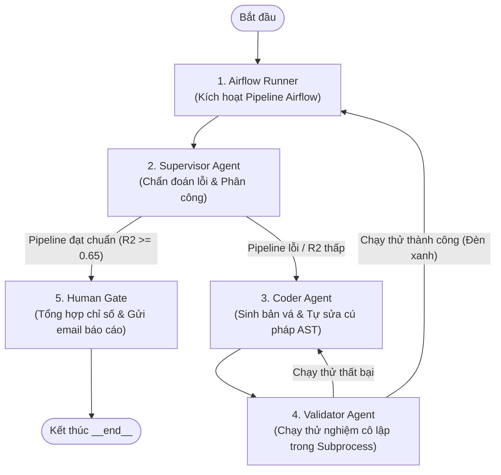

# HƯỚNG DẪN HỆ THỐNG MULTI-AGENT MLOPS TỰ HÀNH (AURA MVP)

> **Dành cho thành viên trong nhóm:** Tài liệu này giúp bạn nắm bắt nhanh toàn bộ hệ thống Multi-Agent chỉ trong **3 phút**, biết cách chạy lệnh và biết phải sửa file nào khi cần.

---

## 1. TỔNG QUAN (Hệ thống này làm gì?)

Đây là hệ thống **Multi-Agent tự hành** phục vụ chu trình MLOps của dự án Aura Real Estate:
1. **Tự động điều phối Pipeline:** Kích hoạt Airflow chạy chu trình ML (từ làm sạch dữ liệu, huấn luyện Stacking Regressor đến đánh giá).
2. **Tự động bắt bệnh:** Nếu Pipeline chết hoặc điểm số mô hình thấp ($R^2 < 0.65$), Agent sẽ tự động đọc log lỗi và định vị chính xác file bị hỏng trong 24 micro-modules.
3. **Tự động sửa code thực tế:** Tự sinh mã vá lỗi, tự kiểm tra lỗi cú pháp (AST), tự chạy thử nghiệm trong môi trường cô lập trước khi cho phép chạy thật.
4. **Báo cáo cho con người:** Tự tính toán thời gian khắc phục sự cố (MTTR), xuất file Markdown, PDF và gửi Email cho quản trị viên.

---

## 2. LUỒNG HOẠT ĐỘNG GIỮA 5 AGENT

Hệ thống gồm **5 Agent chuyên trách** phối hợp nhịp nhàng với nhau:



### Nhiệm vụ cụ thể của từng Agent:
* **`Airflow Runner` ([`agents/airflow_runner.py`](agents/airflow_runner.py)):** Bấm nút chạy DAG trên Airflow. Nếu Airflow tắt hoặc đứt mạng, nó tự lấy kết quả cũ từ đĩa lên chạy tiếp và đánh dấu cảnh báo.
* **`Supervisor` ([`agents/supervisor.py`](agents/supervisor.py)):** "Trưởng nhóm" đọc log lỗi, tra cứu danh mục 24 file micro-modules để tìm file cần sửa.
* **`Coder` ([`agents/coder.py`](agents/coder.py)):** "Lập trình viên" viết code sửa lỗi. Có rào chắn AST tự rà soát dấu ngoặc, thụt lề trong RAM tối đa 3 lần, code chuẩn mới được ghi vào đĩa.
* **`Validator` ([`agents/validator.py`](agents/validator.py)):** "Tester" chạy thử code mới trong một tiến trình con riêng biệt (Dry-Run Subprocess) để đảm bảo không bị lỗi import hay chết chương trình.
* **`Human Gate` ([`agents/human_gate.py`](agents/human_gate.py)):** "Cổng phê duyệt" tính thời gian sửa lỗi (MTTR), xuất file báo cáo `latest_audit_report.md`, tạo file PDF và gửi email.

---

## 3. BẢN ĐỒ THƯ MỤC (Cần sửa gì thì mở file nào?)

```
agent/
├── agents/                   # CHỨA LOGIC CỦA 5 CON BOT
│   ├── airflow_runner.py     # Gọi Airflow API
│   ├── supervisor.py         # Chẩn đoán và phân công
│   ├── coder.py              # Viết code sửa lỗi
│   ├── validator.py          # Kiểm thử an toàn
│   └── human_gate.py         # Tổng kết và gửi báo cáo
│
├── tools/                    # CÔNG CỤ DÙNG CHUNG CHO CÁC BOT
│   ├── sandbox.py            # Đọc/ghi file an toàn, kiểm tra cú pháp AST, sinh Git Diff
│   ├── test_runner.py        # Thử nạp module và chạy Smoke Test
│   ├── airflow_bridge.py     # Kết nối Airflow & Đọc file summary đĩa
│   ├── alert_tools.py        # Gửi email SMTP
│   └── pdf_report_generator.py # Biên soạn file PDF báo cáo
│
├── core/                     # BỘ ĐIỀU KHIỂN TRUNG TÂM
│   ├── state.py              # Cấu trúc bảng đen AgentState
│   └── engine.py             # Động cơ chuyển trạng thái đồ thị (Graph Engine)
│
├── metrics/                  # NƠI LƯU KẾT QUẢ ĐO LƯỜNG
│   ├── collector.py          # Bộ đếm MTTR, Pass@1, Pass@3
│   └── latest_audit_report.md# File báo cáo Markdown mới nhất
│
├── tests/                    # CÁC BÀI TEST TỰ ĐỘNG
│   ├── test_tools.py         # Test 6 công cụ nền tảng
│   └── test_workflow.py      # Test toàn bộ luồng E2E 5 bot
│
├── main.py                   # FILE CHÍNH ĐỂ CHẠY HỆ THỐNG
└── README.md                 # Tài liệu này
```

---

## 4. HƯỚNG DẪN CHẠY NHANH (MÌ ĂN LIỀN)

Mọi người trong team có thể copy-paste chạy ngay trên máy cá nhân mà không cần cài thêm cấu hình phức tạp:

### Bước 1: Chạy kiểm thử xem hệ thống có xanh không
```powershell
python agent/tests/test_tools.py
python agent/tests/test_workflow.py
```
*(Nếu hiện `TOÀN BỘ BÀI KIỂM THỬ ĐÃ VƯỢT QUA 100%` là máy bạn đã sẵn sàng).*

### Bước 2: Chạy hệ thống Multi-Agent 1 lần (Single Run)
```powershell
python -m agent.main --mode once
```
*Lệnh này sẽ tự kích hoạt luồng 5 agent, chẩn đoán, và xuất file báo cáo tại `agent/metrics/latest_audit_report.md`.*

### Bước 3: Chạy chế độ giám sát liên tục (Daemon)
```powershell
python -m agent.main --mode daemon --interval 300
```
*(Cứ mỗi 300 giây hệ thống sẽ tự động quét trạng thái MLOps một lần).*

---

## 5. CÁC TÌNH HUỐNG VẬN HÀNH THỰC TẾ (FAQ)

### Q1: Code gốc của dự án có bị Coder Agent ghi đè làm hỏng không?
* **Không.** Hệ thống dùng kiến trúc **Dual-Sandbox**:
  * Thư mục `agent/sandbox/baseline/`: Chứa mã nguồn chuẩn mốc, được bảo vệ 100%, không agent nào được sửa.
  * Thư mục `agent/sandbox/update_code/`: Nơi Coder Agent đề xuất bản vá để test thử. Con người kiểm duyệt Git Diff thấy ổn mới nạp vào production.

### Q2: Nếu LLM sinh code lỗi cú pháp (quên đóng ngoặc, sai thụt lề) thì sao?
* Tool `sandbox.py` có tích hợp thư viện `ast.parse()`. Bất kỳ đoạn mã nào sai cú pháp sẽ bị **từ chối ghi ngay lập tức**. Coder Agent sẽ nhận lại dòng/cột lỗi để tự sửa lại trong bộ nhớ tối đa 3 lần.

### Q3: Nếu Airflow bị mất mạng hoặc chưa bật Webserver thì phiên có bị sập không?
* **Không bị sập.** Hệ thống tự kích hoạt chế độ **Local Fallback**:
  * Tự tìm file `pipeline_summary.json` gần nhất trong `model_registry/` để đọc kết quả cũ.
  * Email và Báo cáo sẽ hiện cảnh báo màu đỏ ở đầu:  
    `⚠️ [CẢNH BÁO]: Tuần này Airflow gặp sự cố kết nối, hệ thống nạp kết quả phiên trước từ đĩa để thẩm định!`
